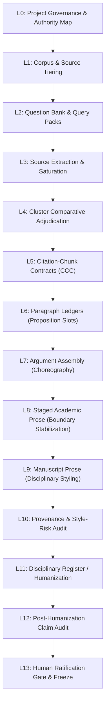

# ARS LITERATURE-REVIEW SESSION HANDOFF — WORKFLOW STATE

**Document Location:** `docs/design/2026-10-21-literature-review-session-handoff/02_LITERATURE_REVIEW_WORKFLOW_STATE.md`  
**Governing Architecture:** L0 through L13 Governed Literature-Review State Machine  
**Active Worktree:** `C:\ReposGitHub\academic-research-skills-literature-review` (`feat/literature-review`)  
**Date:** 2026-10-21, America/Santiago  

---

## 1. The 14-Stage Governed Lifecycle Model

The literature-review skill in ARS implements a deterministic, evidence-first lifecycle spanning fourteen discrete stages ($L_0$ to $L_{13}$):

### Stage Definitions & Canonical ARS Components

| Layer | Stage Name | Artifact Convention | Canonical ARS Software / Schema | Production Validation Status |
|---|---|---|---|---|
| **$L_0$** | **Project Governance & Authority** | `00_control_bundle/` | `control_bundle_manifest_schema.json` `control_bundle_validator.py` | Validated in `paper-k-stock` (5/5 suites pass) |
| **$L_1$** | **Corpus & Source Tiering** | `01_corpus/` | Corpus tiering specification (Tiers A–D) | Validated across 11 canonical sources |
| **$L_2$** | **Iterative Question Bank** | `02_questions/` | Query pack bundling protocol | Validated (eliminates ad-hoc search loops) |
| **$L_3$** | **Extraction & Saturation** | `03_source_notes/` | Saturated note contract (`SRC_*.md`) | Saturated across 11 primary sources |
| **$L_4$** | **Comparative Cluster Adjudication**| `04_cluster_notes/` | Thematic comparative matrices | Validated across 6 thematic clusters |
| **$L_5$** | **Citation-Chunk Contracts** | `04_cluster_notes/` | `CCC_*` contract schema | Validated (enforces $\text{Cluster} \neq \text{Claim}$) |
| **$L_6$** | **Paragraph Ledgers** | `06_paragraph_ledgers/` | `paragraph_ledger_schema.json` | 11 ledgers fully ratified (`LOCK`) |
| **$L_7$** | **Argument Assembly** | `08_argument_assembly/` | `argument_assembly_schema.json` | 11 units / 66 slots fully ratified (`LOCK`) |
| **$L_8$** | **Staged Academic Prose** | `09_staged_prose/` | `staged_prose_schema.json` | 66 staged sentences fully ratified (`LOCK`) |
| **$L_9$** | **Manuscript Prose** | `manuscript/sections/` | `manuscript_prose_contract_schema.json` | Drafted in LaTeX (`02_capital_measurement.tex`) |
| **$L_{10}$** | **Provenance & Style Audit** | `07_reports/` | `style_risk_auditor.py` | Validated: Risk `LOW` (0 triads, 0 dumps) |
| **$L_{11}$** | **Disciplinary Register** | `10_manuscript_prose/` | `humanization_protocol.md` | Authorial polishing stage |
| **$L_{12}$** | **Claim-Immobility Audit** | `07_reports/` | `claim_immobility_auditor.py` `post_humanization_audit_schema.json` | Validated: 66/66 sentences `PASS` |
| **$L_{13}$** | **Human Ratification Gate** | `09_HUMAN_RATIFICATION_LEDGER.md`| State machine lock / freeze | Active Human Gate: `P01–P11 FIRST DRAFT` |

---

## 2. Core Epistemic Finding from Live Production

The deployment of this pipeline in `paper-k-stock` established a fundamental law of agentic scholarship:

$$\mathbf{EVIDENTIARY\ CORRECTNESS} \not\equiv \mathbf{SUCCESSFUL\ AUTHORIAL\ PROSE}$$

### Analysis of the Divergence
1. **What Technical Validation Proven:**
   - Every substantive assertion traced unbroken to a locked ledger slot (0 unsupported sentences).
   - All negative boundaries, threshold qualifications, and source exclusions were strictly obeyed.
   - All 18 automated structural style-risk patterns (triads, colon-scaffolding, citation dumping, marketing adjectives) were successfully avoided or suppressed to `LOW`.
   - The document compiled flawlessly in TeX Live (`pdflatex`, exit code 0).
2. **What Human Author Review Disclosed:**
   - Despite passing all formal validators, the text lacked the idiosyncratic cadence, deep narrative propulsion, and effortless disciplinary mastery of experienced senior human scholars.
   - The prose was syntactically correct and evidentiary unassailable, but stylistically flat, overly cautious, and rhythmically monotonous.
3. **Architectural Implication for ARS:**
   - **A Human Prose-Quality Gate is Non-Negotiable.** No matter how sophisticated automated style auditors or claim-immobility verifiers become, automated passes cannot certify that text is publication-ready literature.
   - Provenance tools establish *negative boundaries* (what must NOT be violated), not *positive aesthetic excellence* (what constitutes compelling scholarly prose).

---

## 3. Deliberate Governance Stance

> [!IMPORTANT] Design Invariant
> **DO NOT** attempt to "solve" this finding by adding new prompt heuristics, automated rewrite loops, or additional algorithmic checkers in the current session.  
> 
> The appropriate architectural response is to recognize the boundary of automated capability: automated tools govern evidentiary integrity; human scholars govern publication prose voice and aesthetic commitment.
