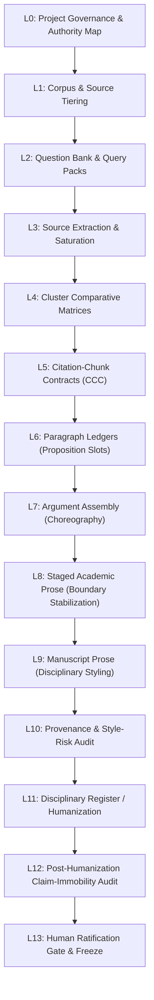

# Literature Review Skill (Governed Evidence-to-Prose Architecture)

## 1. Overview & Core Philosophy

This skill provides a rigorous, auditable, and pass-efficient workflow for producing academic literature reviews grounded in primary texts. It eliminates paragraph-by-paragraph source re-interrogation by organizing evidence consolidation across distinct, verifiable layers.

> **CENTRAL SCHOLARLY PRINCIPLES:**
> 1. **Evidence Precedes Writing:** Manuscript paragraphs ($P_1 \dots P_J$) are downstream consumers of a saturated local evidence vault.
> 2. **Cluster Membership $\neq$ Common Claim Membership:** Co-occurrence in a theme never warrants joint attribution without an explicit citation contract.
> 3. **Intermediate Representations Insulate Evidentiary Bounds:** Paragraph ledgers answer *what may be claimed*; Argument Assembly answers *why each claim is here, in what order, and what must remain separate*; Staged Prose answers *what is the simplest restrained scholarly expression with boundaries stabilized*; Manuscript Prose answers *how the author expresses it in target journal register*.
> 4. **The Claim-Immobility Law:** Stylistic humanization and polishing may vary rhythm, syntax, and cadence, but may **NEVER** alter empirical bounds or strengthen claims.
> 5. **Human Sovereignty:** The human author approves changes to the epistemic perimeter, not every mechanical transformation within it.

---

## 2. Complete Governed Lifecycle (L0 through L13)

Projects may halt at any meaningful intermediate state (e.g., stopping at locked ledgers or argument assembly). The pipeline never forces premature progression to prose.

---

## 3. The 14 Governed Stages

### L0 — Project Governance & Authority Map (`00_control_bundle/`)
- Declares the **Authority Hierarchy**:
  - *External Scholarly Literature:* Original primary texts (`TIER_A`, `TIER_B`, `TIER_C`).
  - *Internal Methodological Predecessors:* Foundational dissertations/monographs (`TIER_D`).
  - *Executable Data / Code Repositories:* Active empirical pipelines (`TIER_D`).
  - *Current Manuscript Governance:* Paper analytical architecture and paper-owned constructs.
- Declares the machine-readable state machine (`08_CURRENT_STATE.yaml`).

### L1 — Corpus Registry & Source Tiering (`01_corpus/`)
- Assigns literature to tiers: `TIER_A_CORE` (multi-theme anchors), `TIER_B_SUPPORTING` (single-cluster contributors), `TIER_C_CONTEXTUAL` (framing), `TIER_D_INTERNAL_AUTHORITY` (exempt from external extraction).

### L2 — Iterative Question Discovery & Query Packs (`02_questions/`)
- Synthesizes atomic questions: $Q_{\text{bank}} = Q_{\text{project}} \cup Q_{\text{legacy}} \cup Q_{\text{source}}$.
- Bundles atomic questions into reusable **Query Packs** (`QP_<FAMILY>`) to extract maximum evidence in minimum passes.

### L3 — Bounded Source Passes & Extraction Saturation (`03_source_notes/`)
- Interrogates primary texts using replaceable backends (or local reading).
- Records canonical source notes (`SRC_<KEY>.md`) with exact locators, verbatim anchors, preserved author terms, and negative boundaries (`Does NOT Establish`).
- Evaluates `EXTRACTION-SATURATED` status, locking sources against routine re-interrogation.

### L4 — Cluster Comparative Matrices (`04_cluster_notes/`)
- Cross-tabulates saturated source notes into comparative matrices across shared atomic questions.

### L5 — Citation-Chunk Contracts (`04_cluster_notes/`)
- Locks binding **Citation-Chunk Contracts** (`CCC_*`) defining common denominators, internal divergences, permitted joint citations, excluded members, and prohibited overclaims.

### L6 — Paragraph Ledgers (`06_paragraph_ledgers/`)
- Maps intended paragraphs to proposition slots ($S_1 \dots S_n$). Answers: **What may be claimed?**
- Classifies slots into canonical provenance classes: `DIRECT SOURCE CLAIM`, `AUTHORIAL SYNTHESIS`, `ADJUDICATED CROSS-LITERATURE HINGE`, `TRANSITION`.
- Attaches explicit `prohibited_stronger_claim` guardrails.

### L7 — Argument Assembly (`07_argument_assembly/`)
- First-class intermediate representation answering: **Why is each claim here? In what order? How may sources be related? What must remain separate?**
- Governed by `literature-review/schemas/argument_assembly_schema.json`.
- Enforces cross-literature weave decisions and strict do-not-weave boundaries.

### L8 — Staged Academic Prose (`08_staged_prose/`)
- Restrained academic prose used to stabilize claim boundaries, order, and citations before publication styling.
- Follows plain subject-verb syntax, transparent attribution, and zero ornament.
- Governed by `literature-review/schemas/staged_prose_schema.json`.

### L9 — Manuscript Prose (`sections/` or `09_manuscript_prose/`)
- Transforms Staged Prose into publication-ready disciplinary text based on locked ledgers and target journal registers.
- Permitted to compress syntax, combine sentences, and vary cadence; strictly forbidden from inventing claims, adding evidence, or strengthening causality.
- Governed by `literature-review/schemas/manuscript_prose_contract_schema.json`.

### L10 — Provenance & Style-Risk Audit (`07_reports/`)
- Verifies that every sentence traces back to locked ledger slots.
- Deterministically audits prose against the **18 Structural Style-Risk Families** using `literature-review/scripts/style_risk_auditor.py`.

### L11 — Disciplinary Register / Humanization
- Smooths syntax, rhythm, and flow to eliminate robotic cadences while observing the **Claim-Immobility Law**.

### L12 — Post-Humanization Claim-Immobility Audit (`07_reports/`)
- Mandatory sentence-by-sentence verification using `literature-review/scripts/claim_immobility_auditor.py`.
- Classifies sentences: `SUPPORTED`, `TRANSITION`, `PURE_RHETORICAL_CONNECTIVE`, `UNSUPPORTED`.
- Any `UNSUPPORTED` sentence or causal escalation triggers immediate audit **FAIL**.

### L13 — Human Ratification Gate & Freeze (`00_control_bundle/09_HUMAN_RATIFICATION_LEDGER.md`)
- Authorial review and explicit human lock across Class A artifacts, ledgers, and manuscript text.

---

## 4. Human-Sovereign Governance & Autonomous Repair

### 4.1 Seven Exclusive Human Reserved Powers
1. Corpus admission;
2. Architecture modification;
3. Scholarly lock ratification;
4. Contribution hierarchy adjudication;
5. Novelty and priority claims;
6. Manuscript prose acceptance;
7. Irreversible version control actions (commit/push).

### 4.2 Bounded Autonomous Local Repair
Agents autonomously execute up to **4 repair iterations** between human gates following:
$$\text{AUDIT} \longrightarrow \text{IDENTIFY DEFECT} \longrightarrow \text{SMALLEST VALID REPAIR} \longrightarrow \text{RE-AUDIT} \longrightarrow \text{CONVERGENCE CHECK}$$

Loops halt and escalate immediately if an uncataloged source is required, an existing lock is affected, or two iterations yield zero progress.

---

## 5. Replaceable Backend Adapters & Offline Execution

The skill is completely decoupled from any single proprietary retrieval API:
- **`MockExtractionBackend`:** Zero-network offline testing and deterministic synthetic regression.
- **`LocalNotesBackend`:** Direct extraction from local Markdown source notes.
- **`NotebookLMAdapter`:** Optional CLI adapter for Google NotebookLM workspaces.

Personal executable paths and credentials must **NEVER** enter Git.
