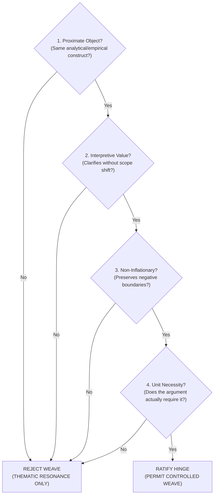

# Cross-Literature Hinge Protocol

**Specification ID:** `literature-review/references/cross_literature_hinge_protocol.md`  
**Lifecycle Stage:** `L4 — CLUSTER ADJUDICATION`, `L5 — CITATION CONTRACTS`, `L7 — ARGUMENT ASSEMBLY`  

---

## 1. Foundational Epistemic Rule

> **THE INTERWEAVING INVARIANT:**  
> **INTERWEAVE LITERATURES ONLY WHEN THERE IS AN ADJUDICATED HINGE.**  
>  
> Co-occurrence in the same bibliographic cluster, common thematic interest, or sharing a broad keyword (e.g., "capital", "productivity", "crisis") is **NEVER** sufficient warrant to combine, synthesize, or jointly cite distinct authors.  
>  
> **`CLUSTER MEMBERSHIP ≠ COMMON CLAIM MEMBERSHIP`**

---

## 2. The Four-Part Adjudication Test

Before any proposition, paragraph ledger slot, or argument assembly decision may interweave claims from distinct authors or theoretical traditions, the relationship must pass all four criteria:

### Criterion 1: Conceptual or Empirical Proximity
- *Test:* Are the authors analyzing the same concrete object, metric, or empirical relationship, or does the comparison rely on a metaphorical or semantic coincidence?
- *Failure Example:* Conflating Marxian value composition of capital ($C/v$) with empirical asset composition of machinery vs structures ($\kappa$).

### Criterion 2: Interpretive Value Without Scope Shift
- *Test:* Does juxtaposing the two authors illuminate an empirical anomaly, methodological tension, or theoretical boundary without shifting the analytical scope between micro and macro, or physical and nominal?
- *Failure Example:* Using micro plant-level appraisal heuristics (Harcourt) to refute macro national accounting identities (Robinson) without establishing an explicit aggregation bridge.

### Criterion 3: Non-Inflationary Boundary Preservation
- *Test:* Does the synthesis preserve the exact qualifications, scope limits, and disagreements of both original authors, or does the bridge silently create a stronger, unearned claim that neither author demonstrated?
- *Failure Example:* Asserting that Author Alpha and Author Beta "jointly prove" that measured productivity is purely an artifact of accounting deflators, when Author Alpha explicitly proved that price movements may reflect genuine technological change in capital-goods producing sectors.

### Criterion 4: Paragraph / Argumentative Necessity
- *Test:* Does the specific paragraph or paper contribution actually require interweaving the two traditions, or is it decorative erudition that distracts from the core empirical spine?
- *Rule:* If the paragraph's argumentative job can be achieved with single-author claims, separate exposition is strictly preferred.

---

## 3. Relation Classes Taxonomy

Every cross-source relationship within cluster notes, paragraph ledgers, and argument assembly units must be assigned to exactly one of the following five relation classes:

| Relation Class | Definition | Permitted Wording & Citation Scope | Forbidden Moves |
|---|---|---|---|
| **`DIRECT SOURCE CLAIM`** | Empirical finding, theorem, or direct assertion made by a single source text. | Cites single author/source text with exact locators. | Attributing to multiple authors across traditions; generalizing beyond source proof. |
| **`AUTHORIAL SYNTHESIS`** | Current paper's own analytical framing, empirical construct, or negative boundary. | Warrants internal governance/method authority alongside external literature context. | Passing off author's own construct as a consensus of the cited literature. |
| **`ADJUDICATED CROSS-LITERATURE HINGE`** | Governed bridge comparing, contrasting, or reconciling distinct authors passing Criteria 1–4. | Governed by an explicit Comparative Citation Contract (`CCC_*`). Preserves tensions. | Smoothing over real theoretical disagreements; joint citation strings without contract. |
| **`TRANSITION`** | Structural connective linking concluding consequence of unit $N$ to premise of unit $N+1$. | Summarizes conceptual consequence; no new external citations. | Introducing unledgered empirical facts or external theories. |
| **`THEMATIC RESONANCE ONLY — DO NOT INTERWEAVE`** | Authors share thematic interest or keyword but fail Criteria 1–4. | Must be treated in separate paragraphs or explicitly separated clauses. | Blending claims, creating joint citation strings `(A, 2010; B, 2015)`, or asserting consensus. |

---

## 4. Citation-Chunk Contracts (`CCC_*`)

When two or more sources are permitted to support a joint formulation under an `ADJUDICATED CROSS-LITERATURE HINGE`, the relationship must be governed by a formal **Citation-Chunk Contract**:
1. **Common Denominator:** The precise, narrow intersection where both authors strictly agree.
2. **Internal Divergences:** The exact points where the authors diverge in methodology, assumptions, or implications.
3. **Permitted Joint Citation Chunk:** The exact parenthetical citation string permitted in prose (e.g., `(AuthorA, 2016; AuthorB, 2019)`).
4. **Excluded Members When Narrowed:** Sources that drop out of the citation chunk as soon as the proposition shifts from general definition to specific mathematical implementation.
5. **Prohibited Stronger Formulation:** The explicit boundary stating what the joint citation chunk must NOT be used to assert.
