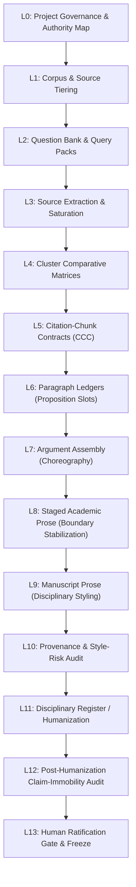

# Literature-Review Workflow Specification (v2.0.0 — Governed Lifecycle)

**Specification ID:** `literature-review/references/workflow_specification.md`  
**Governing Architecture:** L0 through L13 Full Governed Pipeline  
**Status:** CANONICAL WORKFLOW SPECIFICATION  

---

## 1. Foundational Design Philosophy

The Academic Research Skills Literature Review architecture eliminates paragraph-by-paragraph source re-interrogation (`P_j → backend → prose`) by operating evidence consolidation across distinct, verifiable layers:
1. **Source Level ($L_1 \dots L_3$):** Saturated single-source notes (`SRC_*.md`).
2. **Cluster Level ($L_4 \dots L_5$):** Comparative matrices and citation-chunk contracts (`CLUS_*.md`, `CCC_*`).
3. **Ledger Level ($L_6$):** Structured proposition slots defining *what may be claimed*.
4. **Assembly Level ($L_7$):** Argument assembly defining *why each claim is here, in what order, and what must remain separate*.
5. **Staged Prose Level ($L_8$):** Restrained, plain-syntax prose stabilizing claim boundaries and citations.
6. **Manuscript Level ($L_9$):** Publication-ready disciplinary text.
7. **Audit & Humanization Level ($L_{10} \dots L_{12}$):** Provenance verification, style-risk auditing, and mandatory post-humanization claim-immobility verification.
8. **Ratification Level ($L_{13}$):** Immutable human scholarly lock.

> **CORE PRINCIPLE:** Projects may stop at any meaningful layer (e.g., stopping at locked ledgers or argument assembly). The workflow never forces premature progression to manuscript prose.

---

## 2. The 14-Stage Governed Pipeline

### L0 — Project Governance & Authority Map (`00_control_bundle/`)
- Declares the **Authority Hierarchy**:
  - *External Literature:* Authoritative for external theories and findings.
  - *Internal Methodological Predecessors:* Authoritative for internal formulation lineage; not cited as external predecessors in manuscript prose.
  - *Executable Data / Code Repositories:* Authoritative for variable definitions and empirical transformations.
  - *Current Manuscript Governance:* Authoritative for paper analytical architecture and paper-owned metrics.
- Enforces strict human-sovereignty gates and declares machine-readable state (`08_CURRENT_STATE.yaml`).

### L1 — Corpus & Source Tiering (`01_corpus/`)
- Categorizes literature into explicit tiers:
  - `TIER_A_CORE`: Multi-theme anchors (1–2 comprehensive Query Pack passes).
  - `TIER_B_SUPPORTING`: Single-theme or cluster contributors (1 targeted pass).
  - `TIER_C_CONTEXTUAL`: Bounded contextual support (1 lightweight pass).
  - `TIER_D_INTERNAL_AUTHORITY`: Project authorities (exempt from external extraction).

### L2 — Iterative Question Bank & Query Packs (`02_questions/`)
- Synthesizes atomic questions: $Q_{\text{bank}} = Q_{\text{project}} \cup Q_{\text{legacy}} \cup Q_{\text{source}}$.
- Bundles atomic questions into reusable **Query Packs** (`QP_<FAMILY>`) to minimize extraction passes.

### L3 — Bounded Source Extraction & Saturation (`03_source_notes/`)
- Extracts primary text evidence via replaceable retrieval backends (or local reading).
- Normalizes into canonical source notes (`SRC_<KEY>.md`) recording exact locators, verbatim anchors, preserved author terms, and negative boundaries (`Does NOT Establish`).
- Evaluates the **`EXTRACTION-SATURATED`** gate, locking the source against routine re-interrogation.

### L4 — Cluster Comparative Adjudication (`04_cluster_notes/`)
- Cross-tabulates saturated source notes into comparative matrices across shared atomic questions.
- Identifies common denominators, theoretical divergences, and incommensurate assumptions.

### L5 — Citation-Chunk Contracts (`04_cluster_notes/`)
- Formulates binding **Citation-Chunk Contracts** (`CCC_*`) enforcing:
  $$\text{Cluster Membership} \neq \text{Common Claim Membership}$$
- Explicitly locks: candidate proposition, source-by-source support, common denominator, meaningful divergences, permitted citation string, excluded sources when narrowed, and prohibited overclaims.

### L6 — Paragraph Ledgers (`06_paragraph_ledgers/`)
- Constructs slot-by-slot proposition tables ($S_1 \dots S_n$) answering: **What may be claimed?**
- Classifies every slot into canonical provenance classes:
  - `DIRECT SOURCE CLAIM`
  - `AUTHORIAL SYNTHESIS`
  - `ADJUDICATED CROSS-LITERATURE HINGE`
  - `TRANSITION`
- Attaches explicit `prohibited_stronger_claim` guardrails to every slot.

### L7 — Argument Assembly (`06_paragraph_ledgers/` or `07_argument_assembly/`)
- First-class intermediate representation answering:
  *Why is each claim here? In what order? How may sources be related? What must remain separate?*
- Choreographs: opening moves, claim sequences, weave decisions, do-not-weave boundaries, citation choreography, and concept ownership boundaries.

### L8 — Staged Academic Prose (`08_staged_prose/`)
- Restrained academic prose stabilizing claim boundaries, order, and citations before stylistic tailoring.
- Follows plain subject-verb syntax, transparent attribution, and zero decorative ornament. Evidentiary boundaries remain fully inspectable.

### L9 — Manuscript Prose (`sections/` or `09_manuscript_prose/`)
- Transforms Staged Prose into publication-ready disciplinary text based on locked ledgers and target journal registers.
- Permitted to compress syntax, combine sentences, and vary cadence; strictly forbidden from inventing claims, adding evidence, or strengthening causality.

### L10 — Provenance & Style-Risk Audit (`07_reports/`)
- Verifies that every sentence traces back to locked ledger slots.
- Scans prose deterministically for the **18 Structural Style-Risk Families** (`style_risk_auditor.py`).

### L11 — Disciplinary Register / Humanization
- Polishes syntax, rhythm, and flow to eliminate robotic cadences while observing the **Claim-Immobility Law**.

### L12 — Post-Humanization Claim-Immobility Audit (`07_reports/`)
- Mandatory sentence-by-sentence verification (`claim_immobility_auditor.py`).
- Every sentence must be classified as `SUPPORTED`, `TRANSITION`, or `PURE_RHETORICAL_CONNECTIVE`. Any `UNSUPPORTED` sentence or strengthened claim triggers immediate audit **FAIL**.

### L13 — Human Ratification Gate & Freeze (`00_control_bundle/09_HUMAN_RATIFICATION_LEDGER.md`)
- Authorial review and explicit human lock across Class A artifacts, ledgers, and manuscript text.
